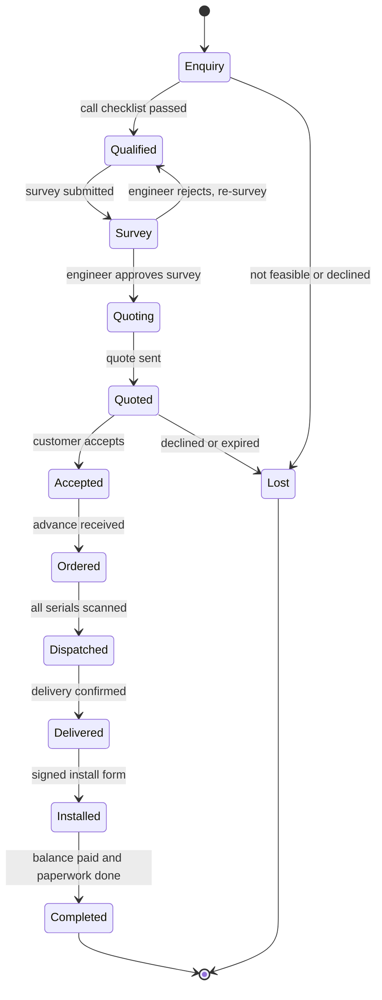
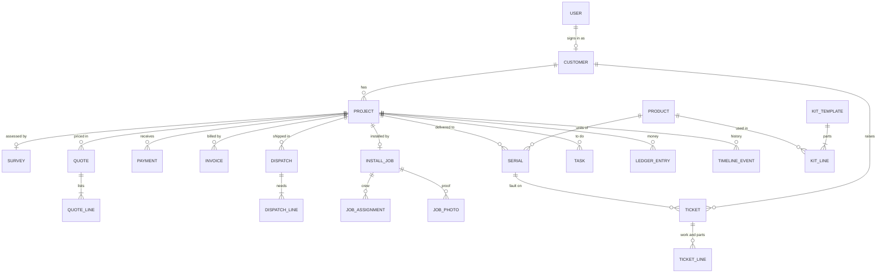

# SunThread — Solar Installation Management System

*Working title · Solution blueprint for SunPower Solutions · written for a 24-hour build · v1.1, 2026-10-31*

**What changed in v1.1.** The customer is now a real user, not a link recipient. Customers send their own enquiry with their own details, and use a **customer portal** to track the project, approve and pay, see documents and warranty, and raise and confirm service requests. Affected: §0, §1, §2 (roles, portal), §3 (T1, T2, T6–T8, T11, T12, T14, T16), §4 (accounts, visibility, payment status), §5.1, §6 (portal screens), §7, §8 (demo), §9 (auth), §10–§13 and §15.

**How to read this.** §0–§2 are the solution at pitch level. §3–§7 are the rules, data and screens a team builds from. §8–§12 cover demo, architecture, plan, tests and risks. §13 lists the defaults chosen where the problem statement is silent. §14 is the pitch outline. §15 traces every sentence of the problem statement to the part of the solution that answers it.

---

## 0. TL;DR

SunPower's teams each do their own job reasonably well. What breaks is the **handoff** between them: enquiry → survey → quote → warehouse → crew → customer → support → director. Every handoff runs on WhatsApp, paper and memory, so something is dropped each time.

SunThread replaces that trail with **one `Project` record per customer, running from the first enquiry to the last day of the 20-year warranty**, and makes each handoff happen by itself. **The customer is inside that thread:** they send their own enquiry with their own details, then follow, approve, pay and raise service requests from a portal, and they only ever see their own data.

Three ideas carry the design:

1. **One Project, one serial trail.** Every enquiry becomes a Project that only ever advances through stages. Every panel, inverter, battery and charge controller has a `Serial` row, tied to the Project when it is scanned at dispatch. That one link answers "which unit went to which customer", "when does the warranty end" and "find the inverter in seconds".
2. **Rules that block, not reminders.** Seventeen workflow transitions (§3), each with a guard and automatic effects inside one DB transaction. No quote before survey approval. No order before the advance. No dispatch with an unscanned serial. No ticket closed without the customer's confirmation.
3. **A ledger and a timeline.** Every rupee in or out is written once against the Project, so profit per job is a sum. Every automatic action writes a visible timeline line, so the automation can actually be seen. Some of those lines are written in plain language for the customer, which is what drives the portal tracker.

| Today | With SunThread |
|---|---|
| Enquiries scattered over WhatsApp, calls and a form; details retyped by whoever picks up; some vanish | The customer enters their own details once, at source, into one inbox. Every enquiry has an owner and a 30-minute first-call task, and can only end as *Lost + reason* |
| Customers phone the office to ask "where is my order?" | Customer portal: stage tracker, next step, schedule, documents and warranty, moved by the same rules that move the project |
| Quotes typed by hand; parts missed | Quote built from a template (type × kW) plus survey data. Sending is blocked if a required part category is missing |
| Serial numbers on paper | Scanned at dispatch, linked to the customer; warranty dates computed on delivery |
| Site work in registers; photos on phones | Mobile install form with checklist, times, photos, geotag and the customer's on-screen signature → handover certificate |
| No revenue or margin picture | Per-project ledger → live profit per job; warranty repairs post back to the original job |

---

## 1. The problem, restated

SunPower completes ~40 rooftop projects a month with 15 technicians. Failures happen at the seams:

| Seam | What gets lost today | Design answer |
|---|---|---|
| Customer → enquiry → sales | Enquiries on WhatsApp, calls, form; details retyped | Customer submits their own details; one inbox, owner + SLA task, no deletes |
| Sales → survey → quote | Quotes sent before the roof is checked; parts missed | Survey gate; template + survey-driven parts list; completeness check |
| Quote → warehouse → crew | Phone calls to say "pack this" and "go there" | Payment ≥ advance auto-creates pick list and schedule slot |
| Warehouse → warranty | Serial numbers on paper | Scan at dispatch; warranty computed at delivery |
| Crew → office | Registers, scattered photos | Mobile form → handover certificate |
| Support → finance | Fault, warranty and cost are disconnected | Serial → warranty status → ₹0 or auto-invoice → cost posts to original job |
| Everything → director | No margin picture | Per-job ledger and a live dashboard |
| Company → customer | Customers ring to ask for status, dates and warranty | Customer portal driven by the same rules |

**Design principles**

1. One record for the life of a customer.
2. The serial number is the 20-year key.
3. Rules are enforced by the system, not remembered by people.
4. Automation must be visible (timeline, notifications, customer tracker).
5. Every rupee has a job to belong to.
6. A customer sees their own project and nothing else: never costs, margins, stock or other customers.

**Deliberately not building:** a real payment gateway (the portal has a demo checkout), SMS/OTP verification, GST filing, WhatsApp Business API, native mobile apps, multi-warehouse, full double-entry accounting.

---

## 2. Solution at a glance

### Roles

| Role | Does | Main device |
|---|---|---|
| **Customer** | **Real portal user.** Sends their own enquiry with their details; tracks the project; accepts quotes; pays; sees documents and warranty; raises and confirms service requests. Present on site to sign off the install. Sees only their own data | Phone |
| Sales | Owns enquiries, qualification calls, quotes, follow-ups | Laptop |
| Engineer | Approves surveys, overrides the parts check, coordinates the schedule | Laptop |
| Warehouse | Receives stock, scans serials, packs, dispatches | Tablet or laptop + scanner |
| Technician | Surveys, installs, service visits, delivery confirmation | Phone |
| Support | Search, tickets, warranty checks (customers also reach them by phone) | Laptop |
| Accounts | Payments, payment verification, invoices, subsidy tracking, payroll | Laptop |
| Director | Dashboard, configuration, overrides | Laptop or phone |

### Modules (named so Odoo-minded judges map them instantly)

| SunThread module | Contains | Closest Odoo analogue |
|---|---|---|
| Customer Portal | Enquiry, tracker, quotes, payments, documents, warranty, service requests | Portal |
| CRM | Enquiry inbox, pipeline, qualification, survey | CRM + Field Service |
| Quotes | Kit templates, quote builder | Sales (quotation templates) |
| Inventory | Receive stock, serials, pick, dispatch, delivery | Inventory (lots/serials) + Purchase |
| Field Service | Schedule, survey form, install form, handover | Field Service, Project, Timesheets |
| Helpdesk | Universal search, tickets, warranty check, billing | Helpdesk + Repair |
| Accounting | Payments, invoices, subsidy tracker, payroll | Invoicing + Analytic accounting |
| Insights | Director dashboard, profit per job, share | Dashboards / Reporting |

### The project thread



`Project.stage` is the coarse state used for the pipeline and dashboard. Finer states live on the child records (survey, quote, dispatch, install job, ticket).

### Customer accounts and the portal

**How a customer gets an account**
1. **Enquire first (primary).** The `/enquire` form collects their details and requires a password for new customers. The portal account is created and they are signed in at once. Existing customers use the Log in tab; staff-entered customers activate through their one-time invitation link. The installation site must be selected through map search, a dropped pin or the current location; address details are filled automatically.
2. **Staff-entered enquiry (calls and WhatsApp).** Same Project, same inbox. The customer has no login until they use the one-time activation link (`/claim/<token>`, 7-day expiry) that Sales sends from the project page.
3. **Return visits.** Log in with phone or email plus password. "New enquiry" creates another Project under the same Customer.

**What the customer sees.** The portal tracker is a friendly view of `Project.stage`:

| Customer sees | Project stage | Next step shown |
|---|---|---|
| 1. Enquiry received | `enquiry` | "We'll call you within 30 minutes" |
| 2. Eligibility check | `qualified` | "Survey visit on <date>": confirm or ask to reschedule |
| 3. Site survey | `survey`, `quoting` | "We're preparing your quote" |
| 4. Quote ready | `quoted`, `accepted` | "Review and accept", then "Pay advance ₹X" |
| 5. Order confirmed | `ordered` | "Installation on <date>", crew name and phone |
| 6. On the way | `dispatched` | Delivery note with serial numbers |
| 7. Delivered | `delivered` | "Warranty started": warranty card |
| 8. Installed | `installed` | Handover certificate; "Pay balance ₹Y" |
| 9. Paperwork | `installed` / `completed` with open subsidy steps | "Subsidy step 3 of 6" |
| 10. Warranty | `completed` | "Next expiry: <date>" |

**Visibility rule.** A `TimelineEvent` has an internal `message` and an optional `customer_message`. The portal shows only events that have a `customer_message`. Ledger, costs, margins, stock, internal notes, staff tasks and other customers' data never appear in any portal response.

---

## 3. Workflow rules (the engine)

Every transition is one function in `lib/rules/`, wrapped in a DB transaction. **Screens never change a stage directly.**

| # | Transition | Who | Blocked unless (guard) | Happens automatically |
|---|---|---|---|---|
| T0 | Receive stock | Warehouse | Serial count equals qty for tracked items; no duplicate serials; unit cost entered | `Serial` rows created `in_stock` with cost, or stock moved in and average cost updated. Any `awaiting_stock` dispatch that is now fully available moves to `to_pick` and the warehouse is notified |
| T1 | Submit enquiry | **Customer** (enquiry form, signed in or not), or Sales for a phone/WhatsApp enquiry | Name, 10-digit phone, address, pincode, property type, package interest; honeypot empty | Customer upserted by phone (a repeat enquiry attaches to the open project instead of duplicating; the submitter never sees existing data). Project at `enquiry`, owned by that customer; their answers are stored as **declared** values. If a password was set, the portal account is created and they are signed in; otherwise an activation link is queued. Owner = sales user with fewest open leads. "First call" task due in 30 min. Sales notified. The customer sees "Enquiry received" with a reference code |
| T2 | Record qualification | Sales | Call outcome recorded; declared shadow-free area, monthly bill, grid phase, sanctioned load and DISCOM **confirmed or corrected** | Feasibility and suggested kW computed (§5.1). **Pass:** stage `qualified`, Survey created `requested`, surveyor and date auto-assigned, surveyor and customer notified. **Fail:** reasons shown; only exits are resize kW or Lost + reason |
| T3 | Submit survey | Technician (mobile) | Roof direction, tilt, roof type, usable area, cable run, at least 2 photos | Survey `done`, stage `survey`, yield estimate shown, engineer notified |
| T4 | Review survey | Engineer | Survey is `done`; rejection needs a reason | **Approve:** survey `approved`, stage `quoting`, **quote button unlocks**, sales notified. **Reject:** survey back to `requested` (stage `qualified`), or project Lost |
| T5 | Build quote | Sales | Survey `approved` (skipped only for hardware-only Panel Set templates) | Lines generated from the template (type × kW) plus survey adjustments (§5.2). Subsidy info for eligible on-grid homes. Parts-completeness check. Totals and estimated margin |
| T6 | Send quote | Sales | Completeness check passes (Engineer may override with a reason) | Quote `sent`; it appears in the customer's portal and they are notified (in-app plus a prefilled WhatsApp message with a deep link); stage `quoted`; follow-up task in 2 days |
| T7 | Accept quote | **Customer in the portal** (or Sales on their behalf, with a note) | Quote `sent` and not expired; customer ticks the terms and types their name | Quote `accepted`, earlier versions superseded, stage `accepted`. "Collect advance" task for Accounts with the exact amount. The customer is taken to the payment screen |
| T8 | Record payment | **Customer** (pays, or submits a reference), Accounts, Sales | Amount > 0; method; reference for UPI/bank. **Only `confirmed` payments count.** A reference submitted by the customer is `pending` until Accounts verifies it; demo-checkout payments confirm instantly | Receipt issued. If stage is `accepted` and confirmed payments ≥ advance, **the order is confirmed:** stage `ordered`; Dispatch created from the quote's physical lines (`to_pick`, or `awaiting_stock`); install job auto-scheduled (§5.5); subsidy checklist created if eligible; warehouse, assigned technicians and customer notified |
| T9 | Pick and scan | Warehouse | Per scan: serial exists, is `in_stock`, matches a line that still needs units, not already scanned | Serial → `reserved` and linked to the Dispatch; line counter increments. Wrong product, duplicate and unknown serials are rejected with a specific message. Dispatch becomes `ready` when every line is complete |
| T10 | Dispatch | Warehouse | Dispatch is `ready`: every serial-tracked line fully scanned and non-serial lines marked packed | Serials → `dispatched`, linked to Project and customer. Non-serial stock moved out. **Material cost posts to the ledger.** Stage `dispatched`. Delivery note with serial list and truck value; the customer sees it in the portal |
| T11 | Confirm delivery | Technician or driver (mobile); the customer may also acknowledge in the portal | Dispatch is `dispatched` | **Warranty starts for every serial** (start = delivery date; end = start + product warranty months). Received-by name stored. Serials → `delivered`. Stage `delivered`. The warranty card appears in the portal |
| T12 | Complete install | Technician (mobile), **with the customer present on site** | Delivery confirmed; all 5 checklist steps ticked; start/finish times valid; system kW confirmed (note required if ≠ quoted); generation-test reading; at least 4 photos; **customer signature and name, signed on the device** | Job `signed_off`; stage `installed`. **Revenue (contract value ex-GST) and labour cost post to the ledger.** Final invoice for the balance created. Handover certificate generated and visible in the customer's portal at once. Subsidy checklist activated. Accounts notified to collect the balance |
| T13 | Complete project | System (automatic) | Balance = 0 and every required subsidy step done or N/A | Stage `completed`; timeline shows the warranty end dates still running |
| T14 | Open ticket | **Customer** (portal) or Support (customer on the phone) | Customer identified; faulty unit chosen from that customer's delivered units (portal), or found by serial or phone (Support), or "no unit" | Ticket created (`source` = portal, call, whatsapp or staff). **Warranty status evaluated from the serial** (§5.3) and shown at once, to the customer as plain text ("Covered until 12 Apr 2027. No charge." or "Warranty ended on 12 Mar 2026. Parts and labour will be invoiced after the visit."). Technician and visit slot auto-assigned and notified. Ticket appears on the original Project's timeline |
| T15 | Resolve ticket | Technician or Support | Resolution notes; hours logged; replacement serial scanned if a unit is swapped | **Covered:** lines marked non-billable, **warranty cost posts to the original project's ledger**, replacement inherits the old unit's warranty end. **Not covered:** lines priced from the price list, service invoice created (payable in the portal), revenue and cost post. Ticket `resolved`; the customer is asked to confirm |
| T16 | Confirm or reopen ticket | **Customer in the portal** (technician can capture it on-device) | Ticket is `resolved` | "Works" → ticket `closed`. "Still not working" → `reopened`, technician notified, reopen counter increments. **No other way to close,** except a Director override with a reason |

Notes:
- Non-serial lines (cables, boxes, structures) are marked "Packed" with a quantity in T9. They never need serials but do block dispatch until packed.
- Panels may be scanned one by one, or pasted as a list or a start–end range.
- T6, T7, T8, T11, T14 and T16 can also be done by staff on the customer's behalf (a phone call, a customer without a smartphone). The timeline records who actually acted.

### Rule-engine contract

- A violation throws `RuleError(code, message)`. The UI shows the message and disables the button with the same text as its tooltip.
- A success writes: a `TimelineEvent` (actor = the user, or `system`), `Notification`s, `LedgerEntry` rows and `MessageLog` rows as applicable.
- **Every rule that changes what the customer should know writes a `customer_message`** in plain language. Events without one stay internal.
- Idempotent: a double-click on dispatch or payment cannot duplicate effects (status checks and unique keys).
- **No hard deletes anywhere.** Use `Lost` and `Void` states with reasons.

### Gate messages (use this exact copy so UI, tests and demo agree)

| Gate | Message |
|---|---|
| Quote before survey approval | "Survey must be approved before a quote can be created." |
| Send with a missing part | "Required parts missing: Earthing kit." |
| Payment below advance | "₹X more needed to confirm the order (advance is 30%)." |
| Reference submitted by customer | "Payment reference received. Your order is confirmed once we verify it." |
| Wrong product scanned | "This is a battery. This order still needs 1 more inverter." |
| Duplicate / unknown serial | "Serial already scanned for SP-2610-0042." / "Serial not in stock." |
| Dispatch incomplete | "3 of 8 serial-tracked units not scanned." |
| Install incomplete | "Customer signature required." / "At least 4 photos required (2 added)." |
| Ticket close | "Waiting for the customer's confirmation." |

---

## 4. Data model



| Entity | Key fields | Notes |
|---|---|---|
| User | name, phone, email, role (staff roles and `customer`), password_hash, active, hourly_rate, can_survey | 15 technicians. Customers sign in with phone or email |
| Customer | name, phone (unique), email, address, city, pincode, consumer_no, discom, **user** (null until the customer sets a password), claim_token, invited_at, claimed_at | Phone is the dedupe key. Staff-created customers start without a login |
| Project | code, customer, submitted_by, kind (`ongrid`/`offgrid`/`panelset`), segment (`home`/`factory`), requested_kw, subsidy_eligible, source (`portal`/`call`/`whatsapp`/`webhook`), stage, owner, lost_reason, qualification fields (shadow_free_sqft, monthly_bill, grid_phase, sanctioned_load_kw) kept as **declared** and **verified** values, verified_by, verified_at, contract_value | **The spine.** Never deleted |
| Survey | project, assignee, scheduled_for, customer_confirmed_at, reschedule_request, status (`requested`/`done`/`approved`/`rejected`), roof_direction, tilt_deg, roof_type (`rcc`/`tin`), usable_area_sqft, cable_run_m, shading, photos, reviewed_by, review_note | History kept on re-survey |
| Product | sku, name, category, tracked_by_serial, warranty_months, cost, price, tax_pct, unit | Categories: panel, inverter, battery, charge_controller, structure, wiring_box, protection, earthing, cable, connector, service |
| KitTemplate, KitLine | type, kw, requires_survey; product, qty_rule (`FIXED`/`PER_PANEL`/`CABLE_RUN`/`BY_ROOF`), qty, required_category | The parts list as data. Editing a template affects future quotes only |
| Quote, QuoteLine | project, version, status, kw, panel_count, subtotal, discount, tax, total, subsidy_amount, valid_until, accepted_by_name, accepted_at; product, qty, unit_price, tax_pct, is_auto | Valid for 15 days |
| Payment | project, kind (`advance`/`balance`/`full`/`service`), amount, method (`upi`/`bank`/`cash`/`cheque`/`online_demo`), reference, **status** (`confirmed`/`pending`/`rejected`), submitted_by, verified_by, received_at | Only `confirmed` counts. Money is integer paise |
| Invoice, InvoiceLine | number, project or ticket, kind (`final`/`service`), status, totals | Final invoice deducts payments already confirmed |
| Supplier, PurchaseReceipt, PurchaseLine | supplier, ref, product, qty, unit_cost | Where stock cost comes from |
| Serial | product, serial_no (unique), status (`in_stock`/`reserved`/`dispatched`/`delivered`/`replaced`/`returned`), unit_cost, project, dispatch, delivered_at, warranty_start, warranty_end, warranty_months, replaces, replaced_by, exclusion_reason | **The 20-year key** |
| StockMove | product, qty_delta, reason, project, unit_cost, at | For non-serial items only |
| Dispatch, DispatchLine | project, status (`awaiting_stock`/`to_pick`/`ready`/`dispatched`/`delivered`), vehicle, driver, dispatched_at, delivered_at, received_by; product, qty_required, qty_picked | Serial rows link back via `dispatch` |
| InstallJob, JobAssignment, JobPhoto | project, scheduled_date, customer_confirmed_at, status, started_at, finished_at, kw_confirmed, 5 checklist flags, test_reading_kw, signature, signed_by, signed_at, geo; job, technician, role, present, hours; kind, url | Hours per technician drive labour cost and payroll |
| Ticket, TicketLine | code, customer, project, serial, source (`portal`/`call`/`whatsapp`/`staff`), fault_code, description, status, covered, exclusion_reason, assignee, visit_date, reopen_count, rating (stretch); kind (`part`/`labour`/`visit`), product, qty, unit_cost, unit_price, billable | |
| Task | project, kind, title, seq, owner_role, due_at, done_at, status (`open`/`done`/`na`/`blocked`) | First call, collect advance, verify payment, subsidy steps, follow-ups, collect balance |
| LedgerEntry | project, kind (`revenue`/`cost`), category, amount, occurred_at, ref_type, ref_id, note | Append-only. Corrections are reversing entries. **Never exposed to customers** |
| TimelineEvent | project, at, actor, kind, message, **customer_message** (null = internal only), meta | The "automation you can see" feed, and the source of the customer tracker |
| Document (stretch) | project, task, uploaded_by, kind (`bill`/`id`/`bank`/`other`), url | Customer uploads for the subsidy paperwork |
| Notification, MessageLog | to_user (staff or customer) or to_role, title, link, read_at; customer, channel, template, body, wa_link, sent_at | In-app bell for everyone; outbound customer messages as `wa.me` links |
| Snapshot | token, period, payload, created_by, expires_at | Shared dashboard numbers |
| Config | key, value | advance_pct, sqft_per_kw, tariff, rates, lead time, subsidy table, company details |

### Ledger categories

| Kind | Category | Posted at | Amount |
|---|---|---|---|
| revenue | `contract` | T12 | Accepted quote subtotal after discount, ex-GST |
| revenue | `service` | T15 (billable) | Service invoice subtotal, ex-GST |
| cost | `material` | T10 | Σ serial unit_cost + qty × average cost of non-serial lines |
| cost | `labour` | T12 | Σ present technicians × hours × hourly rate |
| cost | `warranty_material` | T15 (covered) | Parts used, at cost |
| cost | `warranty_labour` | T15 (covered) | Hours × rate |
| cost | `service_material`, `service_labour` | T15 (billable) | At cost |
| cost | `other` | Manual (Accounts) | Transport, permit fees and similar |

---

## 5. Calculations

### 5.1 Qualification and capacity
- The customer's enquiry form supplies area, bill and grid details as **declared** values. T2 requires Sales to confirm or correct them on the call. Both values are kept, and any difference shows in the timeline ("Customer said 600 sq ft; verified 420 sq ft").
- Required area = `requested_kw × sqft_per_kw` (default 100). Feasible if the verified `shadow_free_sqft` is at least that.
- On-grid grid check passes if the DISCOM is known and `sanctioned_load_kw ≥ requested_kw`. Off-grid skips it. Grid phase is recorded for the net-meter application.
- Suggested kW from the bill: `monthly_units = monthly_bill ÷ tariff` (default ₹7/unit); `suggested_kw = round(monthly_units ÷ 120)`, clamped to 1–5. Shown beside the requested size ("Bill suggests 3 kW").
- Fail shows the reasons. The only ways out are resize kW or Lost + reason.

### 5.2 Template → quote lines
- `panel_count = ceil(kw × 1000 ÷ 540)` (1 kW → 2, 2 → 4, 3 → 6, 4 → 8, 5 → 10).
- Quantity rules: `FIXED`; `PER_PANEL` (qty × panel_count); `CABLE_RUN` (`ceil(survey.cable_run_m × 1.1)` metres); `BY_ROOF` (structure SKU by roof type: RCC → `STR-RCC`, tin → `STR-TIN`).
- Inverter SKU is `INV-{kw}K`. Off-grid adds the battery: `ceil(kw ÷ 2)` units of `BATT-48-100`.
- **Panel Set (hardware):** panels, one MC4 pair per panel, 20 m DC cable. No installation line, no survey requirement.
- **Required categories** for On-Grid and Off-Grid: panel, inverter, charge controller, structure, wiring boxes, protection, earthing, cables, installation (plus battery for Off-Grid). Sending is blocked if any has no line.
- Tax is per product. Discount % is capped by config.
- **Subsidy is information, not a line item.** Eligible when `kind = ongrid` and `segment = home`. It shows as "Expected subsidy" and "Net cost after subsidy". The government pays it to the customer, so it is never SunPower revenue. Rates sit in a config table (illustrative: ₹30,000 for 1 kW, ₹60,000 for 2 kW, ₹78,000 for 3 kW and above; verify before real use).
- *Stretch:* estimated yield and payback: `annual_units_per_kw ≈ 1400 × direction_factor × tilt_factor × (1 − shading_loss)`; payback = net cost ÷ (annual units × tariff).

### 5.3 Warranty
- Start = delivery date (T11). End = start + `warranty_months` (calendar months). The months are **snapshotted onto the Serial** at T11, so later catalogue edits cannot rewrite history.
- State on date *d*: `not_started` (no delivery yet), `active` (*d* ≤ end), `expiring` (≤ 60 days left), `expired`.
- **Covered** = `active` or `expiring`, and no exclusion recorded (Support can mark "not covered" with a reason, for example physical damage or lightning).
- Replacement: the new serial's `warranty_end` equals the old one's; old serial → `replaced`; both link to each other.
- Defaults: panels 240 months; inverter, battery and charge controller 24 months.

### 5.4 Profit
- Job profit = Σ revenue − Σ cost on the Project's ledger. Margin % = profit ÷ revenue.
- A job is attributed to the window containing its install sign-off, but its profit **keeps changing afterwards** as warranty costs post.
- In-flight jobs show an **estimated** margin (accepted quote vs standard cost: cost price × qty + crew size × 8 h × rate), greyed and labelled "Est.".
- Company view for a window: cash collected (confirmed Payments), jobs completed and their profit, after-sales cost posted in the window, outstanding balances, pipeline value.

### 5.5 Scheduling (a heuristic, not an optimiser)
- Earliest install date = order confirmation + `lead_time_days` (3; +7 if `awaiting_stock`), skipping Sundays.
- Crew size is 2 for systems up to 3 kW, 3 above. Pick technicians with no job that day, fewest jobs in the next 7 days. If too few are free, try the next day. One job per technician per day.
- Surveys: one technician with `can_survey`, next working day. Service visits: same rule, inside the ticket SLA (24 h).
- The customer sees each proposed slot in the portal and can confirm it or request another; neither blocks the workflow. The Engineer can reassign from the schedule board.

### 5.6 Next action and "stuck"
- `nextAction(project)` = earliest open Task (by due date, then sequence), or the stage's implicit next step.
- A project is **stuck** when its next action is older than its threshold (default 2 days; 14 days for DISCOM steps). This powers the pipeline badges and the director's "unfinished" list.

---

## 6. Screens

### Customer portal (role: customer, phone-first)

| Screen | What the customer does |
|---|---|
| Enquire / Log in | Log in / New customer tabs. The enquiry form collects property type, On-Grid / Off-Grid, capacity 1–5 kW, a required map location with automatic address details, monthly bill, roof area, roof type and subsidy interest. New customers must create a password. Log in by phone or email |
| My projects | One card per project: stage tracker, next step, who is responsible |
| Project detail | The 10-step tracker, a friendly timeline, schedule (survey, install, service visits) with confirm or request-another-slot, crew name and phone |
| Quote | View lines, subsidy box and net cost; accept (tick the terms, type your name) or ask a question |
| Pay | Advance and balance. Demo checkout, or submit a UPI/bank reference for Accounts to verify |
| Documents | Quote, receipts, invoices, delivery note (with serials), handover certificate, warranty card. All print-ready |
| My systems and warranty | Every delivered unit with serial, install date, warranty end and an active / expiring / expired badge |
| Service requests | Raise a request: pick the unit, fault code from the inverter display, description, photos. The warranty verdict appears immediately. Later: confirm "works" or "still not working" |
| Subsidy | Progress through the paperwork steps; upload requested documents (stretch) |
| Notifications | Bell plus WhatsApp deep links |

Public pages: `/` (landing with "Enquire"), `/enquire`, `/login`, `/claim/<token>` (activate a staff-created account), `/share/<token>` (Director snapshot). Everything else requires login.

### Staff app (navigation filtered by role)

| Area | Screens |
|---|---|
| Home | Role home: my tasks, notification bell, today's schedule |
| CRM | Inbox and pipeline (kanban by stage, SLA timers); customer-submitted enquiries show their declared details. **Quick-add** for call and WhatsApp enquiries, with "Send portal invitation". Project detail with tabs: Overview, Qualification, Survey, Quote, Payments, Dispatch, Install, Tickets, Subsidy, **Timeline** (internal view) |
| Quotes | Quote builder (auto-line badges, completeness checklist, margin chip, subsidy box, send, print). Kit templates editor |
| Inventory | Stock overview (on-hand, reserved, available, shortage flags). Receive stock. Serial explorer (search a serial, see its full history). Pick and scan. Dispatch list. Delivery note (print) |
| Field | **My day** (jobs by date, tap-to-call, map link). Survey form. Install form (stepper). Delivery confirmation. Schedule board (coordinator) |
| Helpdesk | **Universal search** (phone, name, serial, project code, ticket code, pincode). Customer 360 (every unit with a warranty badge, open tickets, balances). Ticket board. Ticket detail and work form |
| Accounting | Payments, including **payments to verify**. Invoices to send and collect. Subsidy tracker. Payroll sheet. Add cost |
| Insights | Director dashboard (§7). Job profit detail (waterfall). Share and export |
| Settings | Products, kit templates, config, users, **demo reset** |

### UX rules
- Every gate shows a disabled button with the reason as its tooltip.
- Customer, technician and warehouse screens are mobile-first: one task per screen, steppers, tap targets of at least 44 px.
- Customer pages use plain language and never show costs, margins, stock levels, internal notes or anyone else's data.
- Rupees in `en-IN` grouping (₹1,50,000). Dates `dd MMM yyyy`, stored UTC, shown IST.
- Photos are compressed client-side to at most 1600 px before upload.
- The scan input is always focused; Enter submits; green or red flash on result. A "Scan next (demo)" button exists in demo mode.
- Quote, delivery note, handover certificate, invoice and warranty card are print-styled pages ("Save as PDF"). No PDF library.

### Install form (T12) as a stepper
1. **Checklist:** stands mounted · panels laid · boxes connected · earthing done · generation tested.
2. **Times and size:** start, finish, confirmed system kW, test reading, crew present.
3. **Photos:** array, inverter and boxes, earthing, inverter display (at least 4).
4. **Sign-off:** the customer, who is on site, enters their name and signs on the device; geotag (optional, fail-soft). Submit.

The handover certificate lists the installed capacity, date, crew, **every serial with its warranty end date**, photos, signature and geotag. It appears in the customer's portal the moment the form is submitted. This is the "no doubt about what was installed" document.

---

## 7. Director dashboard

A window toggle (**Today / This week / This month**) drives everything. Each KPI shows its change against the previous window.

**KPI row:** new enquiries (split by source: portal, call, WhatsApp) · quotes sent (₹) · orders confirmed (₹) · cash collected · jobs completed · profit on completed jobs (₹ and %) · open repairs (with oldest age) · outstanding balances (₹).

1. **Which jobs made money.** Jobs completed in the window: customer, kW, type, revenue, materials, labour, warranty/service, profit, margin. Losses in red. Click a row for a waterfall (revenue → materials → labour → warranty → profit).
2. **What is unfinished.** Stage funnel with ₹ per stage, plus a **Stuck list** (project, next action, owner, days stuck). Includes "payment reference waiting for verification".
3. **Repairs still open.** Tickets by status and age. "Resolved, awaiting customer confirmation" is highlighted.
4. **Money to chase and pay.** Invoices to send, balances due, subsidy pending (step and days), technician payroll (hours × rate per technician, CSV export).
5. **Stock.** Shortage list ("to buy"), serial counts, stock value.
6. **Share.** Freezes a read-only `Snapshot` link (7-day expiry), CSV export, and a WhatsApp text summary.

---

## 8. Seed data and demo

### Seed rules
- Dates are **relative to now**, so the demo works whenever it is run. Deterministic RNG. One command resets the DB.
- Volume: 15 technicians (6 can survey), 2 sales, 1 engineer, 1 warehouse, 2 support, 1 accounts, 1 director; ~20 historical projects across 3 months, each owned by a seeded customer.
- **Every seeded user, staff and customer, has a login.** All share one demo password defined in `.env.example` and used by `prisma/seed.ts`. It is for the local demo only and must not be reused anywhere else.
- Anita Rao (the live demo customer) is **not** seeded. She enquires live, and the reset command deletes her.

### Seed catalogue (illustrative prices, ₹)

| SKU | Item | Serial | Warranty (months) | Cost | Price |
|---|---|---|---|---|---|
| PNL-540 | Mono PERC 540 Wp panel | yes | 240 | 11,000 | 13,800 |
| INV-1K / 2K / 3K / 4K / 5K | Solar inverter | yes | 24 | 11,500 / 17,500 / 24,000 / 30,500 / 36,000 | 15,000 / 22,500 / 30,500 / 38,500 / 45,500 |
| MPPT-60 | Charge controller | yes | 24 | 6,500 | 9,000 |
| BATT-48-100 | 48 V 100 Ah lithium battery | yes | 24 | 42,000 | 52,000 |
| STR-RCC / STR-TIN | GI structure, per panel | no | n/a | 1,900 / 1,600 | 2,600 / 2,300 |
| DCDB / ACDB | DC / AC wiring box | no | n/a | 2,400 / 2,200 | 3,600 / 3,300 |
| CBL-DC / CBL-AC | Solar DC / AC cable, per metre | no | n/a | 90 / 120 | 140 / 180 |
| MC4 | Connector pair | no | n/a | 120 | 200 |
| EARTH-KIT / LA-KIT / PROT-SET | Earthing kit / lightning arrestor / isolator + MCB + SPD | no | n/a | 3,200 / 2,800 / 2,600 | 4,800 / 4,200 / 3,900 |
| SVC-INSTALL | Installation, per kW | service | n/a | actual labour | 5,500 |
| SVC-VISIT, SVC-LABOUR | Service visit; labour per hour | service | n/a | n/a | 800; 450 |

Tax: illustrative 5% on equipment and 18% on services; verify before real use.

**Sanity check:** a 3 kW On-Grid on an RCC roof with a 35 m cable run comes to about ₹1.88 lakh ex-GST (about ₹2.0 lakh with tax), at about 28% margin; advance at 30% is about ₹60,000.

### Planted cases (the demo depends on these)

| Case | Setup | Used for |
|---|---|---|
| Ramesh Kulkarni | 3 kW On-Grid, delivered **18 months ago**; inverter has 6 months of warranty left. Has a portal login | Free repair; job margin drops from ~29% to ~15%. His portal shows "My systems and warranty" |
| Farida Sheikh | 2 kW Off-Grid, delivered **30 months ago**; inverter and battery expired, panels still covered. Has a portal login | Auto-billed repair; also shows a panel claim would still be covered |
| Joshi Residence | 2 kW Off-Grid, 12% discount, battery replaced under warranty | The **loss-making** job on the dashboard |
| Battery at month 23 | Warranty ends within 60 days | `expiring` badge |
| Stock | Enough for the demo order; **deliberately short** on 5 kW inverters | Shortage alert and `awaiting_stock` |
| Stuck projects | One waiting on DISCOM for 12 days; one with ₹58,000 balance unpaid for 9 days; one payment reference awaiting verification | The "unfinished" list |
| Live customer | **Anita Rao**, 3 kW On-Grid under subsidy, Whitefield. Enquires live during the demo | The whole week |

### Demo script (about 9 minutes)

Run it **split-screen:** Anita's portal in a phone-sized window on one side, the staff app on the other, so the audience sees her tracker move every time staff act. Switch staff roles between scenes (demo user switcher).

| # | Scene | Who | What happens | Moment to point out |
|---|---|---|---|---|
| 0 | Open on the answer | Director | Dashboard: profit per job, open repairs, stuck list | "We'll come back to this" |
| 1 | The rooftop inquiry | Anita, Sales | Anita fills in the enquiry herself (3 kW On-Grid, subsidy, bill, roof area) and sets a password. Her portal opens at "Enquiry received". Sales gets it instantly with her declared details and an SLA timer. On the call, Sales verifies (420 sq ft, ₹3,400 bill, grid OK) → survey auto-assigned, and Anita's tracker moves to "Eligibility check" with the survey slot. Try "Create quote" | **Blocked:** survey must be approved |
| 2 | Survey | Anita, Technician, Engineer | Anita confirms the slot in her portal. Mobile survey (south, 18°, 35 m, RCC, photos). Engineer approves | Quote unlocks; her tracker says "We're preparing your quote" |
| 3 | Getting the kit right | Sales, Anita, Accounts | Template fills the lines, with the cable length from the survey. Delete the earthing kit → send is blocked. Restore and send. **Anita's portal shows "Quote ready"**; she accepts and pays the advance by demo checkout | **Order confirms by itself:** pick list and crew slot appear. Nobody phoned |
| 4 | Dispatch day | Warehouse, Technician, Anita | Scan panels (paste), inverter, controller. Scan a battery → rejected. Dispatch with a unit missing → blocked. Complete, dispatch, print the delivery note. Confirm delivery on the phone. Anita sees "On the way", then "Delivered" | **Warranty starts for every serial** and her warranty card appears: panels to 2046, inverter to 2028 |
| 5 | On the roof | Technician, **Anita present** | Install stepper: checklist, times, kW, photos. Anita signs on the technician's phone | The handover certificate appears in her portal at once; final invoice; subsidy checklist; profit appears |
| 6 | Rainy-season breakdown | Support, Technician, Ramesh | Ramesh phones in. Support searches his number → his inverter serial → **IN WARRANTY (6 months left)**. Ticket, replace the unit, invoice ₹0. Quick alternative (15 s): Ramesh raises the request in his own portal and sees the warranty verdict immediately. He taps "Works" in his portal | **Closing needs the customer.** Warranty cost lands on his job. Repeat quickly for Farida: out of warranty → invoice auto-built, payable in her portal |
| 7 | Director's month-end | Director | Dashboard now shows Ramesh's margin lower, the loss-making job, stuck list, payroll. Share link and WhatsApp summary | Same numbers, now explained |

---

## 9. Architecture

> **As built:** React + Vite + Material UI frontend; Django 5 (Python) JSON APIs + SQLite backend. All application workflows and printable documents render in React. See HANDOFF.md and frontend/README.md. The Next.js/Prisma text below was the original default and is superseded; the data model and rules remain in Django.

### Default stack (swap if your team is faster elsewhere; the model and rules do not change)
- **Next.js (App Router, TypeScript) + Prisma + SQLite** (zero setup; move to Postgres only if you need a hosted copy). **zod** for validation, **date-fns** for dates, **Tailwind + shadcn/ui**, **Recharts**.
- If the team is Python-first: **Django** works well. Its admin gives you product, template and parts-list CRUD for free, and signals suit the automations. Django's built-in auth also covers customer login.
- **Auth:** one login page for everyone (phone or email plus password, `bcryptjs`, signed httpOnly session cookie). Roles gate three route groups: `(public)`, `(portal)` for customers, `(staff)`. `DEMO_MODE=1` adds a user switcher listing the seeded staff and customers.
- **Customer data scoping:** every portal query goes through helpers that take `customerId` from the session, never from the URL or request body. Portal responses are built from explicit field lists, so costs and margins cannot leak, and the customer timeline is filtered to events that have a `customer_message`.
- **Tokens** exist only for the one-time `/claim/<token>` activation link and the Director's `/share/<token>` snapshots.
- Photos go to `public/uploads`; the DB stores the relative URL. Signature is a PNG data URL (`signature_pad`).
- Notifications: the bell polls `/api/notifications` every 5 s, for staff and customers alike. Plain and reliable.
- Scanning: a focused text input works with USB scanners and phone scanner apps. Camera scanning (`BarcodeDetector` / `html5-qrcode`) is stretch.
- Intake beyond the portal: `POST /api/enquiry` (API key) accepts leads from any channel (WhatsApp BSP, n8n, other forms); Sales quick-add covers phone calls. Outbound customer messages are `wa.me` deep links with prefilled text, so they work without any API approval.

### Repository layout

```
app/
  (public)/  page  enquire  login  claim/[token]  share/[token]
  (portal)/  portal/  projects/[id]  quotes/[id]  pay  documents  systems  requests
  (staff)/   crm  quotes  inventory  field  helpdesk  accounting  insights  settings
  api/       enquiry  upload  notifications  search  auth
lib/
  rules/     t0-receive-stock.ts … t16-confirm-ticket.ts     (the ONLY place stages change)
  calc/      warranty.ts  pricing.ts  yield.ts  schedule.ts  profit.ts  next-action.ts
  portal/    scope.ts  views.ts                              (customer-scoped reads, explicit field lists)
  ledger.ts  timeline.ts  notify.ts  messages.ts  tokens.ts  money.ts  auth.ts
prisma/      schema.prisma  seed.ts
scripts/     e2e-week.ts    (runs the whole week and the gate tests headlessly)
```

---

## 10. Build plan

Assumes 4 people. With 3, drop the P1 portal items first (§ tiers below). Each person owns a **vertical slice** end to end (rules, screens, tests), not "frontend" or "backend". Hours are from kickoff.

| Hours | Work | Checkpoint |
|---|---|---|
| 0–2 | **Everyone together:** confirm §13, repo, full `schema.prisma` from §4, rule function signatures with `RuleError`, **auth (sessions, roles, demo switcher)**, nav shells for staff and portal, seed of catalogue and users | App boots; everyone can log in; DB seeded; all can start in parallel |
| 2–9 | **A Sales, quoting and the portal's front door:** T1, T2, T5–T8, enquiry form with required signup password, portal My projects and tracker, quote builder, quote accept, demo checkout, payments. **B Stock:** T0, serial explorer, shortage logic. **C Field:** T3, T4, mobile shell, My day, schedule heuristic. **D Platform:** timeline with `customer_message`, notifications, ledger, historical seed generator | **H9:** Anita enquires → qualified → surveyed → quoted → accepts → pays → order confirmed (pick list and job appear by themselves), and her tracker moves at every step |
| 9–15 | **B** T9–T11, delivery note, warranty card. **C** T12, handover certificate. **A** invoices, subsidy tasks, portal documents and "My systems and warranty". **D** dashboard v1 (funnel, profit per job table) | **H15:** one customer end to end through install, profit visible, certificate in her portal |
| 15–19 | **C** T14–T16, universal search, ticket screens, portal service requests and confirmation. **A** payment-reference verification, activation-link flow, slot confirm. **B** shortage alerts. **D** dashboard v2 (window toggle, waterfall, stuck list, payroll, share) | **H19:** the whole week runs; **feature freeze** |
| 19–24 | Hardening: `e2e-week.ts` green, seed polish, test on a real phone, empty and error states, rehearse the split-screen demo 3 times, record a backup video, README, slides | Submit |

Staggered sleep: one person rests 3–4 h between H12 and H20 so someone is always awake with context.

### Scope tiers
- **P0 (the demo cannot run without it):** T0–T16, the seed, login and role switcher, the customer enquiry form, portal My projects with the tracker, quote accept and demo checkout, timeline with `customer_message`, notifications, dashboard panels 1–3.
- **P1:** portal documents, warranty page, service requests and confirmation, slot confirmation, payment-reference verification, activation-link flow for staff-entered enquiries, Sales quick-add, shortage alerts, subsidy tracker, invoices list, payroll sheet, share snapshot, geotag, search polish, waterfall.
- **P2:** subsidy document upload, OTP login, customer acceptance of the install in the portal, ticket rating, yield and payback estimate, margin guard (low-margin quotes need Director approval), camera barcode, QR labels, WhatsApp-message-to-lead parser, fault-code hints (for example, insulation faults are common in rain: check connectors and cable for moisture), offline drafts for the install form.

### Cut lines
- If at H9 T0–T8 are not green → drop the kit template editor, and Sales marks quotes "accepted by phone".
- If at H15 the install form is not done → drop geotag and certificate styling; ship the data.
- If at H15 the portal is behind → keep enquiry, tracker, quote accept and checkout; drop documents, warranty page and the request flow (Support still handles tickets by phone).
- H19 → freeze. Fixes only.

---

## 11. Tests

`scripts/e2e-week.ts` runs T1 → T16 for a fresh customer against the rule functions, then asserts these gates. It doubles as the pre-demo health check.

| # | Check |
|---|---|
| G1 | Creating a quote before survey approval is blocked |
| G2 | A payment below the advance leaves the stage at `accepted`; reaching it creates the Dispatch, InstallJob and Tasks |
| G3 | Dispatch with an unscanned serial is blocked |
| G4 | Wrong-product, duplicate and out-of-stock serials are rejected with the right messages |
| G5 | After delivery every serial has `warranty_end = delivery + months` (panel 240, inverter 24) |
| G6 | Install without signature, photos, checklist or valid times is blocked |
| G7 | A covered ticket produces an ₹0 invoice, posts warranty cost to the **original** project, and lowers its margin by exactly that cost |
| G8 | An expired-warranty ticket produces a service invoice with parts and labour; revenue and cost post |
| G9 | A ticket cannot close without customer confirmation; reopening increments the counter |
| G10 | A duplicate enquiry by phone does not create a second customer; Lost requires a reason; no delete endpoints exist |
| G11 | For every project, profit equals revenue minus cost after each transition |
| G12 | A replacement serial inherits the old serial's warranty end |
| G13 | A customer cannot read or modify another customer's project, quote, invoice, ticket or documents by changing ids in the URL or API |
| G14 | No portal response contains ledger, cost, margin, stock or internal-note data; the customer timeline shows only events that have a `customer_message` |
| G15 | An enquiry with a password creates a login and signs the customer in; without one it queues an activation link; the same phone never creates two Customers, and the submitter never sees existing data |
| G16 | A payment reference submitted by the customer stays `pending` and does not confirm the order until Accounts verifies it; demo-checkout payments confirm immediately |

Definition of done for any transition: rule function + UI + timeline entry (with `customer_message` where the customer should know) + test.

---

## 12. Risks

| Risk | Mitigation |
|---|---|
| Scope creep into a full ERP | P0 list is fixed in §10. Anything new must swap with something |
| Portal scope creep | P0 portal is enquiry, tracker, quote accept and checkout; the rest is P1 with a cut line at H15 |
| Customer data leaks across accounts | Scoping helpers take `customerId` from the session only; explicit field lists; G13 and G14 run in the end-to-end script |
| Phone ownership is not verified in the demo | Documented limitation. OTP login is the production fix and a P2 item |
| Schema merge conflicts | One owner for `schema.prisma`; others request changes |
| Automation invisible to judges | Timeline, notification bell, customer tracker; the split-screen demo calls each one out |
| Phone photos are huge and slow | Client-side compression; 4–6 photos max |
| Venue Wi-Fi | Run the demo on localhost with a seeded DB; keep a recorded backup |
| Scanner hardware | A text input works with keyboard-wedge scanners; "Scan next (demo)" as a fallback |
| Date-dependent demo | Seed dates are relative to now; one-command reset |
| Over-engineering scheduling | Heuristic only (§5.5) |

---

## 13. Defaults chosen (change them before H2, not after)

| Decision | Default | Why |
|---|---|---|
| Customer accounts | Real accounts. Enquire first; a required password on the form creates the login. Phone or email plus password. Customers see only their own data | The customer creates their account and sends their enquiry in one form |
| Customer-entered details | Stored as **declared**; Sales verifies on the call | The problem says someone must call and check the basics |
| Staff-entered enquiries | Supported (quick-add, webhook); the customer activates a login later via a one-time link | Calls and WhatsApp still exist |
| Customer payments | Demo checkout confirms instantly; a submitted UPI/bank reference stays `pending` until Accounts verifies | No gateway in scope; verification mirrors real life |
| Phone verification | Not done in the demo; OTP is the production fix | Time |
| Staff authentication | Seeded accounts on the same login page, plus a demo user switcher | Time |
| Advance to confirm an order | 30% of the total including GST (config) | The problem says "advance or full" but gives no figure |
| Panels | Serial-tracked; bulk paste or range scan | The problem gives panels a 20-year warranty per serial |
| Charge controller warranty | 24 months | The problem names inverter and battery at 2 years; same assumed |
| Survey approver | Engineer | A second pair of eyes before a price goes out |
| Warranty start | Delivery confirmation (T11), not install | "The moment a delivery is done" |
| Replacement unit | Inherits the remaining warranty | Common practice; configurable |
| Subsidy | Information on the quote plus a checklist; customer's money, never SunPower revenue | The government pays the customer |
| Revenue timing | Contract value booked at install sign-off | Ties profit to completed jobs |
| Money | Integer paise; ₹ with `en-IN` grouping | Avoids float bugs |
| WhatsApp | `wa.me` links plus an inbound webhook; no Business API | Works with no approval |
| Tax | Per-product %, illustrative seed values | Verify before real invoices |
| Warehouse | One | ~40 jobs a month |

---

## 14. Pitch outline

1. **Open with the director's question:** "Which installations made money, and what is still unfinished?" Show the dashboard for 20 seconds, then say "let's see how those numbers get made."
2. **Tell the week as one customer's story,** with Anita's phone and the staff app side by side (the demo in §8).
3. **Four "watch this" moments:** a blocked action explaining itself; Anita's tracker moving without anyone phoning her; the warranty starting by itself on every serial; a free repair visibly lowering a job's margin.
4. **Close:** "One thread from the first enquiry to the 20-year warranty, and the customer is on it."

| Judging lens | Where we answer it |
|---|---|
| Problem fit | §15: every sentence of the problem statement is traced |
| Completeness | All seven scenes run end to end on one live customer, seen from both sides |
| Technical depth | Transactional rule engine, append-only ledger, serial-level provenance, customer-scoped data access |
| UX | Customer portal and mobile-first field screens; gates that explain themselves; print-ready documents |
| Feasibility | Small stack, seeded data, one-command reset, scripted end-to-end test including security checks |

---

## 15. Traceability: problem statement → solution

| Problem statement | Answered by |
|---|---|
| Enquiries from WhatsApp, calls and a web form get lost | T1: the customer submits their own enquiry; quick-add and `POST /api/enquiry` cover calls and WhatsApp; SLA task; Lost needs a reason; no deletes |
| Homeowner fills in a form online; name, phone, address and needs land with sales straight away | Customer-authored enquiry form (T1): assigned and notified instantly, details kept as declared values |
| Call checks shadow-free space, bill, grid suitability | T2, §5.1 (declared vs verified) |
| Technician measures roof direction, tilt, cable distance | T3 |
| Quote only after the survey is approved | T4 + T5 gate |
| Quote from a ready template; exact parts follow on their own | §5.2, T5 |
| Nobody should have to remember every small part | Templates as data; required-category check in T6 |
| Customer says yes; pays advance or full before work starts | T7 (accept in portal), T8 (pay or submit reference; Accounts verifies) |
| Warehouse knows what to pack; crew sees the job without phoning | T8 effects, notifications, My day |
| Every inverter, battery, controller scanned before it leaves | T9, T10 |
| Know exactly which unit went to which customer | `Serial.project`; serial explorer; delivery note |
| Warranty clock starts by itself per serial (2 and 20 years) | T11, §5.3 |
| Crew notes start and finish times and system size, uploads photos | T12 install form |
| Homeowner signs on screen | T12 sign-off (customer present on site) |
| Clear proof of the job; no doubt about what was installed | Handover certificate (serials, photos, signature, geotag), also in the customer's portal |
| Find the customer and exact inverter serial within seconds | Universal search, customer 360 |
| See whether it is still under warranty | T14 verdict (shown to Support and to the customer), §5.3 |
| In warranty: free. Otherwise parts and labour billed automatically | T15 |
| Ticket tracked until the customer confirms | T15, T16 (confirmation in the portal) |
| Which installations made money and which lost | §7 panel 1, §5.4 |
| What is still unfinished | §7 panel 2, §5.6 |
| Advance payments, stock purchases, technician hours, unfinished steps scattered | `Payment`, `PurchaseReceipt`, `JobAssignment.hours`, `Task` |
| Invoices to send, subsidy paperwork, technicians to pay | Accounting module: invoices list, subsidy tracker, payroll |
| Today, this week, this month; profit per job; open repairs | §7 window toggle and panels |
| Share these numbers | Snapshot link, CSV, WhatsApp summary |
| Panel Set, On-Grid and Off-Grid (1–5 kW), Installation service | Catalogue and kit templates (§5.2, §8) |
| About 40 projects a month, 15 technicians | Scheduling heuristic (§5.5); seed volume |
| Customers are frustrated | Customer portal: tracker, schedule, documents, warranty, service requests (§2, §6) |
