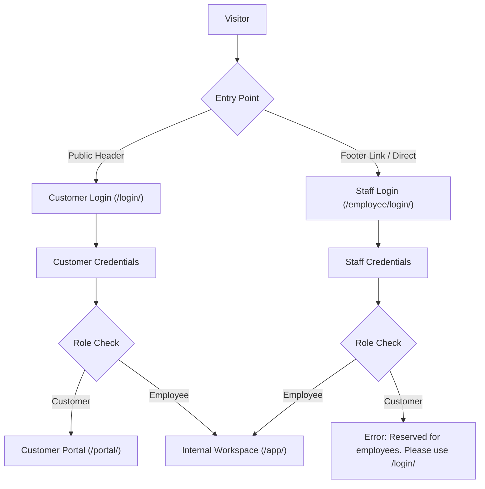

# Feature Spec: Dedicated Employee Login Portal (`/employee/login/`)

**Status:** APPROVED  
**Date:** 2026-11-01  
**Target URL:** `/employee/login/`  

---

## 1. User Impact & Why Now
- **Who is affected:** Internal employees across all departments (Sales, Surveyors/Engineers, Warehouse, Support Desk, Finance/Accounts, Field Technicians, and Administrators) and external solar customers.
- **Why now:** Currently, both customers and staff share the consumer-facing `/login/` screen. Separating the portals eliminates customer confusion, allows employee-specific branding and operational guidance, enforces role-based access boundaries at the front door, and sets up a clean foundation for future internal SSO/MFA integrations.

---

## 2. Current Behavior vs. Desired Behavior

| Dimension | Current Behavior | Desired Behavior |
| :--- | :--- | :--- |
| **Employee Login URL** | Shared at `/login/` | Dedicated endpoint at `/employee/login/` |
| **Customer Login URL** | Shared at `/login/` | Dedicated to customers at `/login/` |
| **Page Layout & Tone** | Public consumer messaging ("One roof, one connected journey", "New customer" tab linking to `/enquire/`) | Professional enterprise portal ("SunPower Employee Workspace", clear department access guidance, no consumer tabs) |
| **Header Navigation** | "Customer & team login" button | "Customer login" button linking to `/login/` |
| **Footer Navigation** | Single public trust line | Adds subtle, unobtrusive **"Staff sign-in"** link directing employees to `/employee/login/` |
| **Cross-Role Access Guard** | Any valid credentials log in and redirect based on role | **Role-guarded:** If a customer attempts to sign in at `/employee/login/`, access is refused with: *"This sign-in is reserved for SunPower employees. Customers, please log in at the Customer Portal (/login/)."* If staff signs in at `/login/`, they are cleanly redirected to `/app/`. |

---

## 3. Scope & Boundaries

### In Scope:
1. **New Route**: Register `path("employee/login/", views.employee_login_view, name="employee_login")` in `backend/sunthread/urls.py`.
2. **Backend Auth Guard**:
   - `employee_login_view` authenticates via `PhoneEmailBackend`.
   - Rejects non-staff (`user.is_customer`) with an explicit error message and preserves session safety.
   - Redirects authenticated staff to `safe_next(request, "/app/")`.
   - Returns 200 JSON contract for React client routing (`api/ui/employee/login/`).
3. **Frontend UI Components**:
   - Dedicated employee sign-in view in React (`Auth.jsx` with `staffMode` or `EmployeeAuth.jsx`).
   - Clean professional layout: SunPower corporate identity, Department badge, Username/Staff Email/Phone identifier, Password field with toggle, Back to site link.
   - Server-rendered fallback template at `frontend/templates/public/employee_login.html`.
4. **Navigation Updates**:
   - Update `PublicHeader` in `frontend/src/components/Common.jsx` from "Customer & team login" -> "Customer login".
   - Update `PublicFooter` to include "Staff sign-in" (`/employee/login/`).
   - Mirror updates in server-rendered templates (`public/base.html`, `public/landing.html`, `public/login.html`).
5. **Automated Testing**:
   - Test employee successful login at `/employee/login/` -> redirects to `/app/`.
   - Test customer blocked at `/employee/login/` with validation message -> stays on `/employee/login/`.
   - Test invalid credentials at `/employee/login/`.
   - Test `next` query parameter forwarding (e.g., `/employee/login/?next=/app/inventory/`).
   - Verify React build and 752-page smoke crawl pass with 0 errors.

### Out of Scope:
- Modifying underlying Django user models or role definitions.
- Changing customer OTP verification behavior for customer `/login/`.
- Third-party SAML/SSO integration.

---

## 4. Technical Architecture & File Changes

### Files Touched:
1. `backend/sunthread/urls.py`: Add route for `employee/login/`.
2. `backend/core/views.py`: Add `employee_login_view(request)` with role-guard logic.
3. `backend/core/api_state.py`: Ensure `/employee/login/` state serializes cleanly into React contract.
4. `frontend/src/pages/Auth.jsx`: Support staff mode layout and role cues.
5. `frontend/src/components/Common.jsx`: Update `PublicHeader` and `PublicFooter`.
6. `frontend/templates/public/employee_login.html`: Fallback HTML template.
7. `backend/core/tests/test_views.py`: Unit tests for `/employee/login/`.

---

## 5. Edge Cases & Failure Modes

1. **Authenticated Session Already Active**: If an already logged-in employee visits `/employee/login/`, immediately redirect to `/app/`. If an already logged-in customer visits `/employee/login/`, show a warning notice with a link to log out or return to `/portal/`.
2. **Deep-link Next Redirect**: If an unauthenticated employee attempts to open `/app/inventory/`, Django redirects to `LOGIN_URL?next=/app/inventory/`. If `LOGIN_URL` defaults to `/login/`, we should also support `safe_next` on `/employee/login/` seamlessly.
3. **Demo Mode User Switcher**: Keep the demo switcher accessible to signed-in staff on `/app/` as configured.

---

## 6. Acceptance Criteria

- [x] Spec approved by user.
- [ ] Navigating to `http://127.0.0.1:8000/employee/login/` renders the dedicated SunPower Employee Workspace login page.
- [ ] Entering valid employee credentials (`arjun` / `SunPower@2026!`) authenticates successfully and redirects to `/app/`.
- [ ] Entering customer credentials on `/employee/login/` fails authentication with message: *"This sign-in is reserved for SunPower employees. Customers, please log in at the Customer Portal (/login/)."*
- [ ] Header on public pages displays "Customer login"; Footer displays "Staff sign-in".
- [ ] Running `npm run build` succeeds with 0 bundle errors.
- [ ] All Django unit tests and crawl tests pass with 0 regressions.
